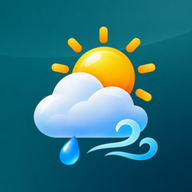
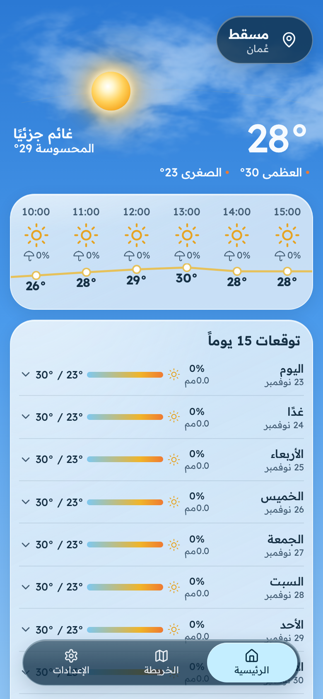
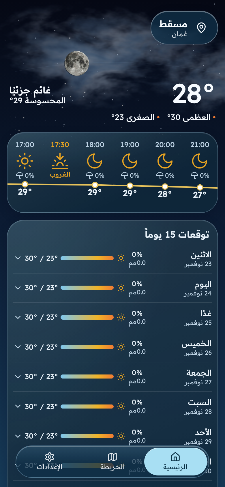
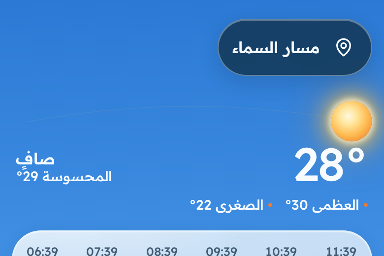
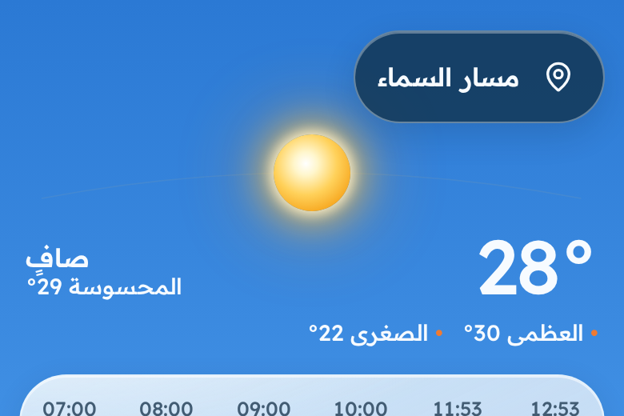
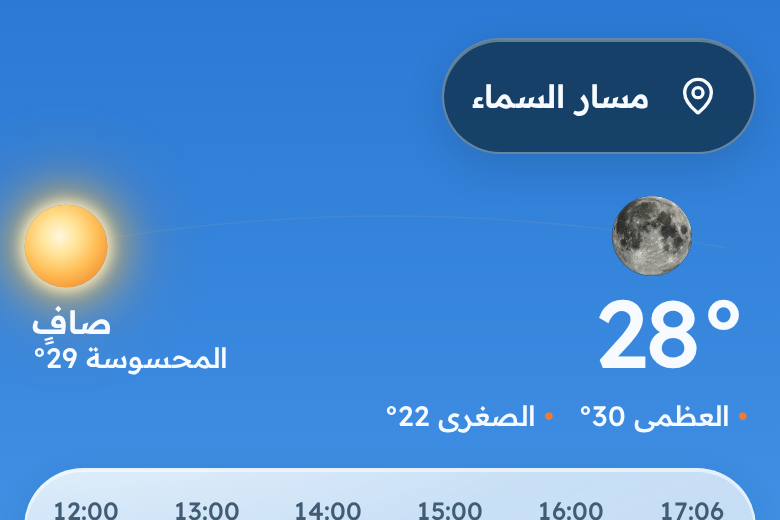

  

<h1 align="center">طقسي | MyWeather</h1>

  طقسك في لمحة، وخريطة تستكشفها، وسماء تتغير مع يومك. 
  Your weather at a glance. A map to explore. A sky that follows your day.

  <a href="#العربية">العربية</a> · <a href="#english">English</a> · <a href="https://nabdhserv.net/">NabdhServ.Net</a>

<h3 align="center">
  <a href="https://t.me/TaqsiApp">📲 تنزيل التطبيق وآخر التحديثات — قناة طقسي على تليجرام</a>
</h3>

  <strong><a href="https://t.me/TaqsiApp">Download the app &amp; get the latest updates — Taqsi on Telegram</a></strong> 
  <a href="https://t.me/TaqsiApp">@TaqsiApp</a>

---

## العربية

**طقسي** تطبيق أندرويد يجمع حالة الطقس والتوقعات والخرائط التفاعلية في واجهة زجاجية أنيقة. تابع طقس موقعك والمدن التي تهمك، واستكشف المطر والسحب والرياح، وشاهد الشمس والقمر يتقدمان على مسارهما مع مرور الوقت في المدينة المختارة.

### تنزيل التطبيق وآخر التحديثات

تابع **[قناة طقسي على تليجرام — @TaqsiApp](https://t.me/TaqsiApp)** لتنزيل التطبيق والاطلاع على أحدث الإصدارات والتحديثات.

### أبرز المميزات

- **الطقس والتوقعات:** الحالة الحالية، الحرارة المحسوسة، وتوقعات ساعية ويومية تصل إلى 15 يومًا بحسب توفر بيانات المزوّد.
- **خرائط تفاعلية:** استكشاف طبقات المطر والسحب والثلج والرياح والتنقل بين أوقات التوقع.
- **سماء حيوية:** سحب وتأثيرات للمطر والثلج ترتبط بالحالة الجوية، مع مظهر نهاري وليلي.
- **مسار الشمس والقمر:** تقدّم الشمس من الشروق إلى الغروب، والقمر وفق طلوعه وغروبه وطورِه؛ وقد يظهر القمر نهارًا عندما يكون فوق الأفق.
- **مدنك وموقعك:** البحث بالعربية والإنجليزية، حفظ المدن المفضلة، تحديد الموقع، والتبديل بين المواقع بالسحب.
- **بوصلة الشمال والقبلة:** اتجاه القبلة والمسافة التقريبية إلى مكة، مع خيار تحديد موقعك للبوصلة.
- **تفاصيل أكثر:** الرياح والرطوبة والضغط والأشعة فوق البنفسجية، ومعلومات جودة الهواء عند توفرها.
- **واجهة مريحة:** بطاقات زجاجية، دعم العربية واتجاه الكتابة من اليمين إلى اليسار، وخيار لتوفير البيانات.

## من داخل التطبيق · Inside the app

<table>
  <tr>
    <th>المشهد النهاري · Day</th>
    <th>المشهد الليلي · Night</th>
  </tr>
  <tr>
    <td align="center"></td>
    <td align="center"></td>
  </tr>
</table>

### سماء تتغير مع الوقت · A sky that follows time

<table>
  <tr>
    <th>قرب الشروق · Near sunrise</th>
    <th>الظهر الشمسي · Solar noon</th>
    <th>قرب الغروب · Near sunset</th>
  </tr>
  <tr>
    <td></td>
    <td></td>
    <td></td>
  </tr>
</table>

تتغير المواضع مع **الوقت الفعلي والموقع المختار**؛ وليست حركة سريعة متكررة. القوس تمثيل بصري لتقدّم الجرم بين الطلوع والغروب، وليس اتجاه بوصلة.

الصور من واجهة التطبيق الفعلية باستخدام بيانات توضيحية ثابتة. أرقام الطقس فيها ليست رصدًا مباشرًا، ويتفاوت توفر التوقعات وتوقيت تحديثها حسب المصدر والموقع.

Positions follow **real elapsed time and the selected location**, rather than a fast repeating animation. The arc illustrates progress between rise and set; it is not a compass bearing.

Screenshots show the actual app interface using fixed illustrative data. Their weather values are not live observations. Forecast availability and update times vary by source and location.

---

## English

**MyWeather (Taqsi)** is an Android weather app that brings current conditions, forecasts and interactive maps into an elegant glass-inspired interface. Follow your location and favorite cities, explore rain, clouds and wind, and watch the Sun and Moon progress through the sky as time passes in your selected city.

### Download & latest updates

Visit **[the Taqsi Telegram channel — @TaqsiApp](https://t.me/TaqsiApp)** to download the app and follow the latest releases and updates.

### Features

- **Weather and forecasts:** current conditions, feels-like temperature, and hourly and daily forecasts extending up to 15 days where provider data is available.
- **Interactive maps:** explore rain, cloud, snow and wind layers across forecast times.
- **A living sky:** weather-driven cloud, rain and snow effects, with distinct daytime and nighttime scenes.
- **Sun and Moon passages:** the Sun progresses from sunrise to sunset; the Moon follows its own rise, set and phase, including daytime visibility when above the horizon.
- **Cities and location:** search in Arabic or English, save favorite cities, use your location and swipe between places.
- **North and Qibla compass:** find the Qibla direction and approximate distance to Mecca, with a location option for the compass.
- **More weather details:** wind, humidity, pressure, UV, and air quality where available.
- **A comfortable interface:** glass-style cards, Arabic and right-to-left support, and a data-saving option.

---

  صنع بعناية · Made with care 
  Made with ♥ By <a href="https://nabdhserv.net/">NabdhServ.Net</a>

